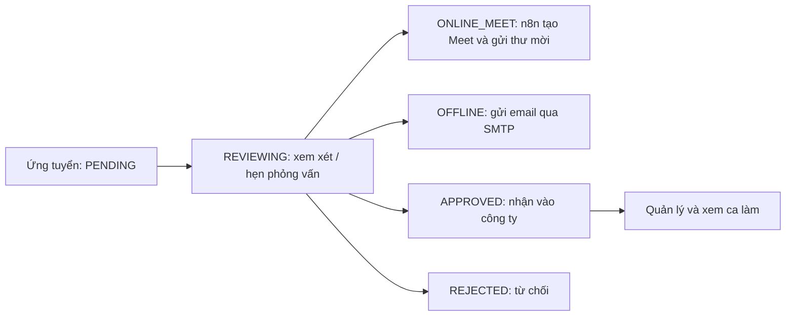

# BakeJobs - Frontend

Frontend của **BakeJobs**, ứng dụng tuyển dụng cho tiệm bánh/F&B, quản lý hồ sơ ứng tuyển, phỏng vấn và phân ca nhân viên. Giao diện dùng React, TypeScript và Vite, kết nối REST API Spring Boot.

Tên thư mục `Jobhunter_FE`, package `react-vite-jobhunter` và một số định danh JobHunter được giữ lại từ nền tảng ban đầu. Tên sản phẩm trên giao diện là BakeJobs.

Tài liệu mô tả source hiện tại; các giới hạn đã biết được ghi ở cuối trang. Xem thêm [README backend](https://github.com/QThang2006/Jobhunter_backend/blob/main/README.md).

## Chức năng hiện có

| Nhóm | Chức năng |
|---|---|
| Khách truy cập | Xem tiệm/công ty, tìm việc theo từ khóa, địa điểm, cấp bậc, lương và kỹ năng |
| Ứng tuyển | Upload CV, nộp hồ sơ khi đã đăng nhập hoặc ứng tuyển nhanh bằng email; mở form từ link chia sẻ/QR |
| Tài khoản | Đăng ký, đăng nhập mật khẩu hoặc Google, khôi phục mật khẩu qua OTP, quản lý tài khoản và hồ sơ |
| Tuyển dụng | Quản lý công ty, tin tuyển dụng/kỹ năng, bật/tắt tin, xem hồ sơ, hẹn phỏng vấn, nhận hoặc từ chối ứng viên |
| Ca làm | Quản lý ca, chuyển ca cho nhân viên khác và có thể đổi ngày; xem lịch ca cá nhân |
| Thông báo | Chuông thông báo, số chưa đọc, đánh dấu đã đọc; cập nhật dữ liệu qua WebSocket |
| Quản trị | Quản lý người dùng, vai trò, quyền API; dashboard thống kê với Recharts |
| Email việc làm | Đăng ký kỹ năng quan tâm; nút trên dashboard gọi API gửi email việc làm |

## Luồng nghiệp vụ

### Tài khoản và ứng tuyển

1. Khách có thể xem việc làm/công ty trước khi đăng nhập.
2. Đăng ký tạo tài khoản rồi chuyển về trang đăng nhập; API đăng ký không cấp JWT để đăng nhập ngay.
3. Đăng nhập trả access token, frontend lưu trong `localStorage`. Refresh token nằm trong cookie HttpOnly do backend cấp. Axios có cơ chế thử refresh và đồng bộ bằng `async-mutex`.
4. Người đã đăng nhập nộp CV qua `POST /api/v1/resumes`.
5. Khách dùng `POST /api/v1/resumes/quick-apply`: backend tìm tài khoản theo email, tạo tài khoản nếu chưa có và gửi mật khẩu tạm qua email. Role `USER` được khởi tạo và dùng mặc định cho tài khoản mới.

Link chia sẻ có dạng `/job/<slug>?id=<jobId>&apply=true`. Trang chi tiết lấy ID từ query `id`; `apply=true` mở form ứng tuyển.

### Hồ sơ và phỏng vấn



Đây là luồng sử dụng chính, không phải sơ đồ ràng buộc mọi chuyển trạng thái ở backend.

- Chọn `REVIEWING` mở modal hẹn ngày/giờ, hình thức và ghi chú phỏng vấn. Form gọi `POST /api/v1/email/approve`; backend cũng hỗ trợ alias `/api/v1/email/schedule-interview`.
- `ONLINE_MEET` gọi n8n để tạo Google Calendar/Meet và gửi Gmail. Nếu không lấy được link Meet, backend có nhánh gửi thư mời bằng SMTP.
- `APPROVED` là quyết định nhận ứng viên: gắn tài khoản với công ty tuyển dụng, xóa thông tin lịch phỏng vấn và gửi thông báo/email nhận việc.
- `REJECTED` xóa thông tin lịch phỏng vấn và gửi email từ chối.

Workflow nằm tại [src/resources/n8n/n8n-interview-meet-workflow.json](src/resources/n8n/n8n-interview-meet-workflow.json). Hướng dẫn cấu hình ở [README backend](https://github.com/QThang2006/Jobhunter_backend/blob/main/README.md).

### Ca làm, thông báo và email việc làm

Ca có các trạng thái `ASSIGNED`, `CONFIRMED`, `COMPLETED`, `TRANSFERRED`, `CANCELLED`. Chuyển ca cập nhật bản ghi hiện tại và thêm lịch sử vào ghi chú. Nhân viên xem ca tại `/my-shifts`, người quản lý dùng `/admin/shift`.

WebSocket sử dụng SockJS tại `/ws` và STOMP. Các thông điệp như `REFRESH`, `NEW_NOTIFICATION` báo frontend gọi REST API lấy dữ liệu mới. Source hiện tại chưa có chức năng chat hoặc trợ lý AI.

Email việc làm được kích hoạt bằng `GET /api/v1/email`. Backend hiện chưa có scheduler gửi email việc làm định kỳ.

## Công nghệ

Phiên bản/range lấy từ [package.json](package.json).

| Công nghệ | Phiên bản/range | Vai trò |
|---|---|---|
| React / TypeScript / Vite | 18.2.0 / 5.3.3 / 4.2.0 | Giao diện, kiểu dữ liệu, dev server và build |
| Ant Design / Pro Components | 5.13.1 / 2.6.46 | Form, bảng, modal và bố cục |
| Redux Toolkit / React Router | 1.9.3 / 6.11.2 | State và định tuyến |
| Axios / async-mutex | 1.6.5 / 0.4.0 | REST API và refresh token |
| stompjs / sockjs-client | ^2.3.3 / ^1.6.1 | Thông báo và tải lại dữ liệu |
| Recharts | ^3.6.0 | Biểu đồ dashboard |
| React Quill / Day.js / Sass | 2.0.0 / 1.11.8 / 1.62.1 | Mô tả tin, ngày giờ và style |

Backend sử dụng Java 17, Spring Boot 3.2.4, PostgreSQL trên Supabase, Supabase Storage, Brevo SMTP và Google OAuth2.

## Cấu trúc source

```text
src/
├── components/
│   ├── admin/          # Công ty, việc làm, hồ sơ, quyền, người dùng
│   ├── client/         # Tìm kiếm, thẻ việc làm, ứng tuyển, tài khoản, ca cá nhân
│   └── share/          # ProtectedRoute, Access, thông báo, lịch ca
├── config/             # API helpers, Axios, quyền API và tiện ích
├── context/            # WebSocket provider
├── pages/
│   ├── admin/          # Dashboard, tuyển dụng, phân ca và quản trị
│   ├── auth/           # Login, register, OAuth2 redirect
│   ├── company/        # Danh sách và chi tiết công ty
│   ├── home/           # Trang chủ
│   ├── job/            # Danh sách và chi tiết việc làm
│   └── shift/          # Trang ca làm cá nhân
├── redux/              # Store, hooks và các slice
├── resources/n8n/      # Bản export workflow phỏng vấn
├── styles/             # SCSS
├── types/              # Kiểu dữ liệu API
├── App.tsx             # Routes
└── main.tsx            # Entry point
```

## Chạy local

Cần Node.js và npm tương thích với dependencies. Repository chưa khai báo `engines` để chốt phiên bản Node/npm; dùng bản Node LTS phù hợp với Vite 4 và kiểm tra build trên môi trường triển khai.

Tại thư mục `Jobhunter_FE`:

```bash
npm ci
```

Tạo `.env.development.local`:

```dotenv
PORT=3000
VITE_BACKEND_URL=http://localhost:8080
VITE_ACL_ENABLE=true
```

```bash
npm run dev
```

Mở [http://localhost:3000](http://localhost:3000). Khởi chạy backend theo [hướng dẫn backend](https://github.com/QThang2006/Jobhunter_backend/blob/main/README.md) nếu dùng URL local.

Hai file `.env.development` và `.env.production` đang trỏ đến backend Render. `.env.development.local` ghi đè cấu hình development và được bỏ qua bởi `.gitignore`. Chỉ sao chép `.env.development` sang `.env` không bảo đảm đổi được backend vì file theo mode có độ ưu tiên cao hơn.

| Biến | Ý nghĩa |
|---|---|
| `PORT` | Cổng dev server; được `vite.config.ts` đọc bằng `loadEnv` |
| `VITE_BACKEND_URL` | URL gốc backend, không thêm `/api/v1` |
| `VITE_ACL_ENABLE` | Bật/tắt kiểm tra quyền ở component `Access` phía giao diện |

Chỉ biến cần đưa vào mã trình duyệt mới dùng tiền tố `VITE_`. Không đặt bí mật trong các biến này. `VITE_ACL_ENABLE=false` không thay đổi cơ chế xác thực/phân quyền của backend.

Google OAuth2 dùng `FRONTEND_URL` trên backend để chọn địa chỉ redirect. Khi chạy local, cấu hình `FRONTEND_URL`, `CORS_ALLOWED_ORIGINS`, `AUTH_COOKIE_SECURE=false` ở backend và redirect URI trong Google Console. Khi deploy HTTPS lên Vercel/Render, giữ `AUTH_COOKIE_SECURE=true` để refresh cookie dùng `Secure; SameSite=None`.

## Routes

| Route | Nội dung | Kiểm tra đăng nhập ở frontend |
|---|---|---|
| `/` | Trang chủ | Không |
| `/job`, `/job/:id` | Danh sách, chi tiết việc làm | Không |
| `/company`, `/company/:id` | Danh sách, chi tiết công ty | Không |
| `/login`, `/register`, `/oauth2/redirect` | Xác thực | Không |
| `/my-shifts` | Ca cá nhân | Có |
| `/admin` | Dashboard | Có, UI giới hạn `SUPER_ADMIN` |
| `/admin/company`, `/admin/user` | Công ty, người dùng | Có |
| `/admin/job`, `/admin/job/upsert` | Tin tuyển dụng/kỹ năng, tạo/sửa tin | Có |
| `/admin/resume`, `/admin/shift` | Hồ sơ, phân ca | Có |
| `/admin/permission`, `/admin/role` | Quyền và vai trò | Có |

Dù route khai báo `:id`, trang chi tiết job/company lấy ID thật từ query `?id=...`; đoạn path dùng cho slug. Menu và thao tác quản trị còn kiểm tra quyền từ tài khoản. Đây là kiểm soát giao diện; cần đối chiếu riêng mức bảo vệ API ở backend.

## Build và triển khai

```bash
npm run build
npm run preview
```

`build` chạy `tsc && vite build`, xuất thư mục `dist/`. `preview` phục vụ bản build để kiểm tra local. `npm run start` là alias chạy Vite dev server, không phải production server.

Production đọc `.env.production` và các override của mode production. Vite đưa các biến `VITE_*` vào bundle lúc build nên đổi URL backend cần build lại. [vercel.json](vercel.json) có rewrite về `index.html` để hỗ trợ SPA routes.

Địa chỉ được tham chiếu trong cấu hình dự án (không xác nhận tình trạng hoạt động):

- Frontend: [jobhunter-fe-one.vercel.app](https://jobhunter-fe-one.vercel.app)
- Backend: [jobhunter-backend-aeu0.onrender.com](https://jobhunter-backend-aeu0.onrender.com)

## Bản sửa và kiểm thử

- Refresh token được đồng bộ giữa các request, không gọi refresh lặp khi cookie hết hạn; lỗi mạng giữ nguyên nguyên nhân và response 204 được chuẩn hóa.
- Hồ sơ cá nhân dùng `GET/PUT /api/v1/users/me`; quyền quản trị user được kiểm tra riêng trên backend.
- Account Redux nhận company từ API, kết thúc loading khi request thất bại và sao chép role trước khi cập nhật.
- Trang ca cá nhân dùng kiểm tra đăng nhập; trang admin kiểm tra vai trò/quyền và không chờ vô hạn khi thiếu role.
- Thông báo cập nhật đúng trường `read`; xóa user chấp nhận HTTP 204.
- Dashboard tải đủ các trang và dùng nguồn job quản trị để tính cả tin đã tắt. Khi dữ liệu lớn, nên chuyển thống kê sang API tổng hợp phía backend.
- WebSocket chỉ kết nối khi đã đăng nhập; backend kiểm tra JWT, topic cá nhân và quyền nhận topic quản trị.

```bash
npm test
npm run build
```

Test dùng Node test runner và TypeScript có sẵn trong dependencies, kiểm tra các tình huống refresh đồng thời/thất bại, lỗi mạng, response 204 và Redux account. Build kiểm tra TypeScript và tạo bundle. Còn cảnh báo của Ant Design về `use client` và bundle lớn; chúng không chặn build.

Google OAuth, email thật, n8n/Meet và hành vi cookie trên trình duyệt production cần kiểm tra sau deploy. Trình duyệt chặn cookie bên thứ ba vẫn có thể giới hạn refresh giữa hai domain khác site.

## Deploy bản sửa

Deploy backend và frontend cùng phiên bản vì frontend dùng endpoint hồ sơ cá nhân mới. Trên Vercel giữ `VITE_BACKEND_URL` trỏ về backend Render, build bằng `npm run build`, output `dist`. Các biến `VITE_*` được đọc lúc build nên thay đổi biến cần redeploy.

Xem danh sách biến bắt buộc trên Render trong [hướng dẫn deploy backend](https://github.com/QThang2006/Jobhunter_backend/blob/main/DEPLOYMENT.md). Các secret cũ đã bị xóa khỏi source hiện tại nhưng vẫn có thể nằm trong lịch sử Git; cần thay credential ở nhà cung cấp.

## Nguồn gốc

Phát triển bởi **Ngô Quốc Thắng / QThang2006**, dựa trên nền tảng series Spring Boot RESTful API của [Hỏi Dân IT](https://www.youtube.com/@hoiDanIT). Chưa có file LICENSE trong source được đối chiếu nên tài liệu không khẳng định giấy phép MIT.
